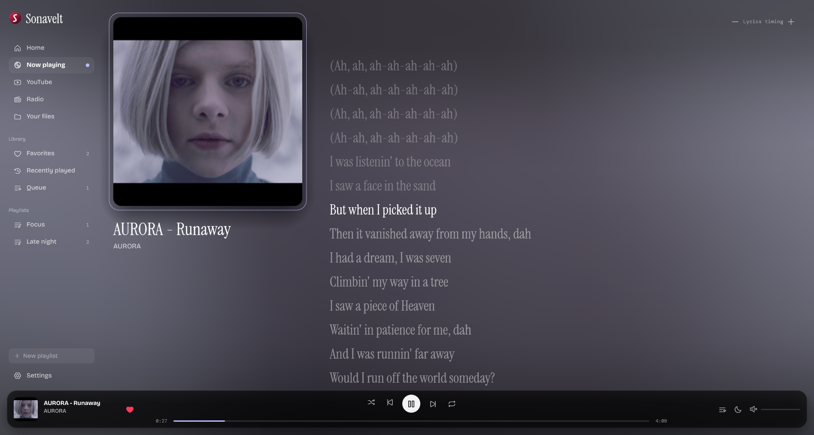
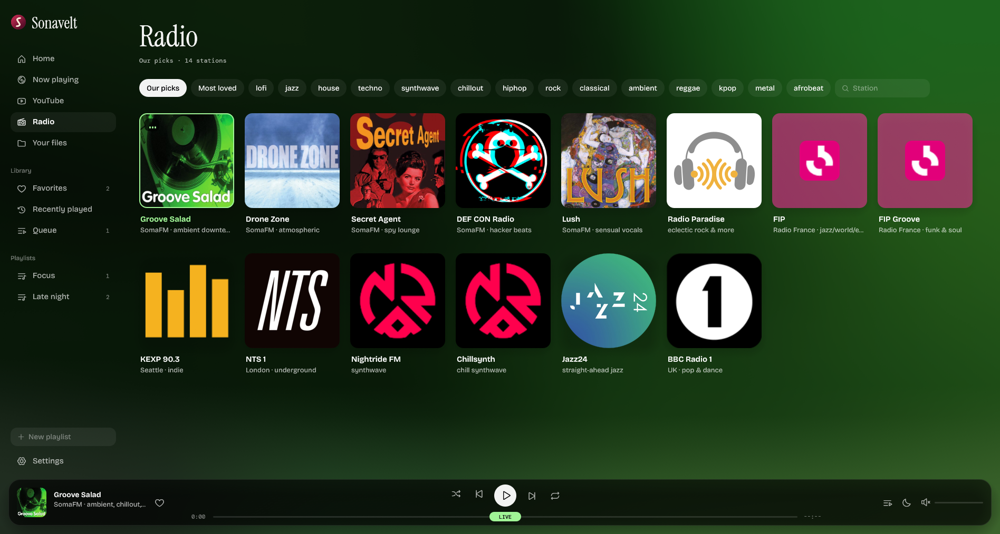
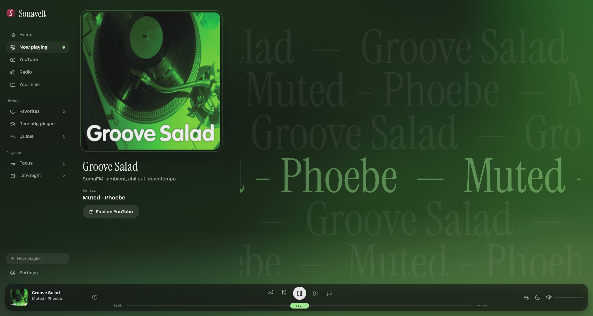
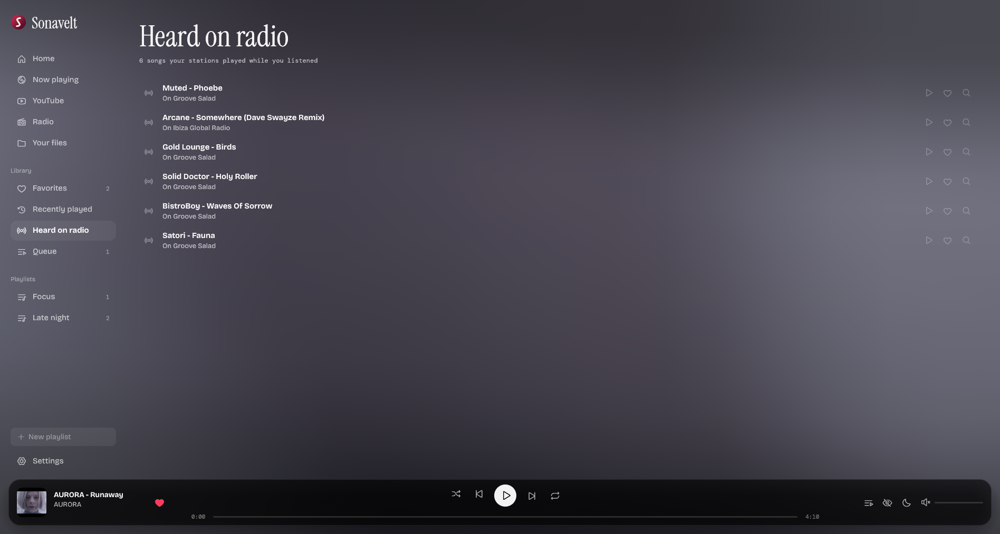

<div align="center">


# Sonavelt

**One music player for YouTube, internet radio and your own files.**
Free, no account, no ads. For Linux and Windows.

[**Download**](https://github.com/Agapenordev/sonavelt/releases/latest) ·
[Install](#install) ·
[Roadmap](ROADMAP.md)

[](https://github.com/Agapenordev/sonavelt/actions/workflows/ci.yml)
[](LICENSE)


</div>

## What it does

| | |
|---|---|
| **Play anything** | Search YouTube, tune into thousands of radio stations, or open a folder of your own music. |
| **Picks for you** | A home page that learns your taste from what you actually listen to. No account needed. |
| **Synced lyrics** | Lyrics scroll along with the song, line by line. |
| **Looks like the music** | The whole app takes its colors from the cover of the song that's playing. |
| **Light** | About 130 MB of RAM. YouTube songs start in about two seconds. |
| **Yours** | Favorites, playlists and history stay in one file on your computer. |

<table>
<tr>
<td></td>
<td></td>
</tr>
<tr>
<td align="center">Synced lyrics</td>
<td align="center">Internet radio</td>
</tr>
<tr>
<td></td>
<td></td>
</tr>
<tr>
<td align="center">Now playing</td>
<td align="center">Songs heard on your stations</td>
</tr>
</table>

## Install

Sonavelt plays music through two free tools: **ffmpeg** and **yt-dlp** (plus **deno**, which
yt-dlp needs for YouTube). Install them first, then download Sonavelt from
[Releases](https://github.com/Agapenordev/sonavelt/releases/latest).

### Windows

```powershell
winget install Gyan.FFmpeg yt-dlp.yt-dlp DenoLand.Deno
```

Download `sonavelt-…-x86_64-windows.zip`, unzip it into a folder you own (for example
`Documents\Sonavelt`) and run `sonavelt.exe`.

### Linux

```bash
# Arch
sudo pacman -S ffmpeg yt-dlp deno
# Fedora
sudo dnf install ffmpeg yt-dlp
# openSUSE
sudo zypper install ffmpeg yt-dlp
# Debian / Ubuntu: get a recent yt-dlp from its releases page or pipx
sudo apt install ffmpeg
```

```bash
tar xzf sonavelt-*-x86_64-linux.tar.gz
./sonavelt-*-x86_64-linux/sonavelt
```

Runs on any x86_64 distro with glibc 2.35 or newer (Ubuntu 22.04, Debian 12, Fedora 36 and later).
On first launch it adds itself to your app launcher.

Sonavelt updates itself: when a new version is out, update from Settings in one click.

## More

<details>
<summary><b>All features</b></summary>

- **Home:** quick tiles, *Made for you*, a shelf per artist you love, *Jump back in* and stations
  for you. Hover a pick to see why it was chosen.
- **It learns from real listening only.** A play counts after 30 seconds. Skips, *Not
  interested* and *Don't recommend this artist* push things down. Block whole genres.
- **Private session:** listen without anything being remembered.
- **YouTube:** search, or paste a video or playlist link. Songs are cached for instant replay, and
  the next one downloads in the background.
- **Radio:** hand-picked stations, the most-loved worldwide, 14 genres and search, from
  [radio-browser.info](https://www.radio-browser.info). Shows the song on air. Dead streams are
  hidden.
- **Your files:** MP3, FLAC, OGG, Opus, M4A and WAV, with their tags and cover art.
- Favorites, playlists, queue, history, Smart Shuffle, M3U export, YouTube playlist import.
- Even out loudness, equalizer presets, lyrics timing nudge.
- Aura, blurred cover or solid background, color moods, interface size, sleep timer.
- Linux: system tray, close to tray, media keys and lock screen controls (MPRIS).

</details>

<details>
<summary><b>Keyboard shortcuts</b></summary>

| Key | Action |
|---|---|
| <kbd>Space</kbd> | Play or pause |
| <kbd>←</kbd> <kbd>→</kbd> | Back or forward 5 seconds |
| <kbd>↑</kbd> <kbd>↓</kbd> | Volume |
| <kbd>N</kbd> / <kbd>P</kbd> | Next / previous |
| <kbd>L</kbd> | Lyrics |
| <kbd>F</kbd> | Favorite the current song |

</details>

<details>
<summary><b>Build from source</b></summary>

```bash
git clone https://github.com/Agapenordev/sonavelt
cd sonavelt
cargo build --release
```

You need a recent stable Rust toolchain. On Linux, also the ALSA development headers
(`alsa-lib-devel`, `libasound2-dev` or `alsa-lib`).

</details>

<details>
<summary><b>How it works</b></summary>

- **UI:** [egui](https://github.com/emilk/egui) on OpenGL, painted by hand. The background is a
  color mesh built from a 4×4 sample of the cover art.
- **Audio:** `ffmpeg` decodes every source to raw PCM, played through
  [cpal](https://github.com/RustAudio/cpal).
- **YouTube:** `yt-dlp` streams into the player while the full file saves to the cache.
- **Your data:** `library.json` in your config folder (`~/.config/sonavelt` on Linux,
  `%APPDATA%\sonavelt` on Windows). Downloads and artwork live in the cache folder.

</details>

## Contributing

Bug reports, ideas and pull requests are welcome: see [CONTRIBUTING.md](CONTRIBUTING.md). Using an
AI coding agent? Point it at [AGENTS.md](AGENTS.md).

## Credits

Lyrics from [LRCLIB](https://lrclib.net), radio directory from
[radio-browser.info](https://www.radio-browser.info). Fonts:
[Instrument Serif](https://github.com/Instrument/instrument-serif),
[Bricolage Grotesque](https://github.com/ateliertriay/bricolage) and
[DM Mono](https://github.com/googlefonts/dm-mono) (SIL OFL). Icons:
[Phosphor](https://phosphoricons.com) (MIT). Station logos and artwork belong to their owners.

Sonavelt plays YouTube through `yt-dlp`. Please respect YouTube's terms and the artists whose
music you enjoy.

[MIT](LICENSE) © 2026 Agapenordev
