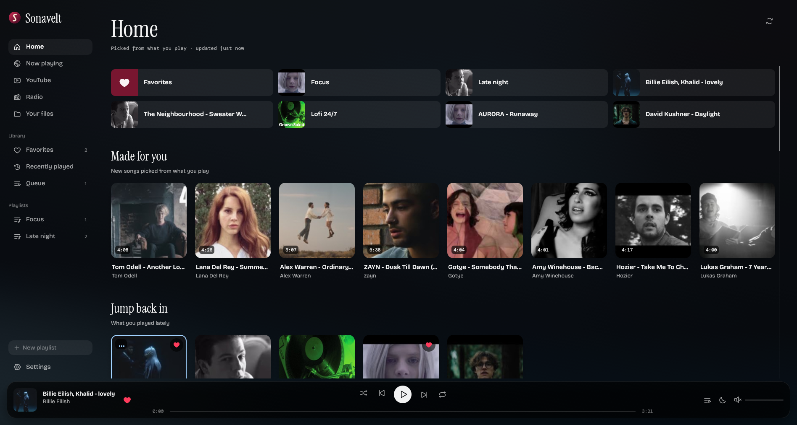
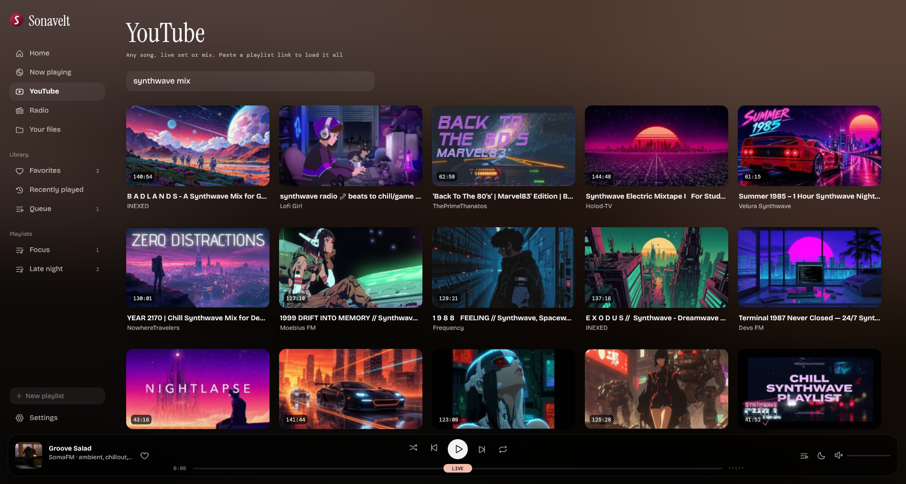
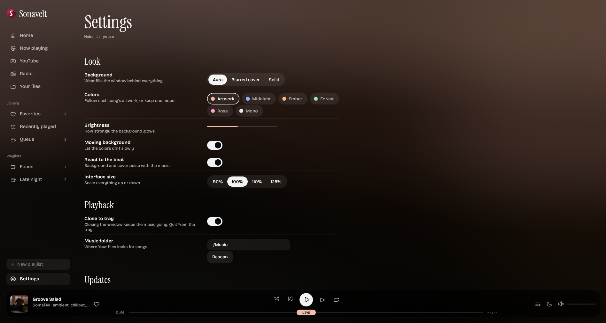

<div align="center">


# Sonavelt

**A fast, native music player for Linux.**
YouTube, internet radio and your own files in one place, with synced lyrics. Written in Rust.

[](https://github.com/Agapenordev/sonavelt/releases/latest)
[](https://github.com/Agapenordev/sonavelt/actions/workflows/ci.yml)
[](LICENSE)


</div>

## What makes it different

Every song re-themes the whole app. Sonavelt reads the colors of the cover art and turns them
into a slow, living background (the *aura*) that breathes with the beat. The accent color,
the progress bar and the hearts all follow along. Songs with lyrics show them line by line, big
and in sync. Songs without them fill the space with the title in huge sliding letters, like a
gig poster.

It is also built to be light: it uses about 130 MB of RAM, idles at around 2% of one CPU core,
and starts YouTube songs in about two seconds.

## Features

**A home page that knows your taste**
- Like Spotify's: quick tiles for your favorites, playlists and recent plays, then shelves of
  picks. *Made for you*, *More like* the artists you play most, *Jump back in* and *Stations for you*.
- Picks come from YouTube's own Mix for the songs that say the most about your taste, combined
  and ranked: songs several of your favorites point to come first, and songs you already know
  are left out.

**Listen to anything**
- **YouTube:** search for any song, mix or live set, or paste a video or playlist link. Songs
  start in about 2 seconds while they download, then replay instantly from the cache.
- **Internet radio:** hand-picked stations (SomaFM, Radio Paradise, FIP, KEXP, NTS, Nightride FM,
  Jazz24, BBC Radio 1), the most-loved stations worldwide, 14 genres and search by name, all from
  [radio-browser.info](https://www.radio-browser.info).
- **Your files:** point it at a folder of MP3, FLAC, OGG, Opus, M4A or WAV files. Embedded cover
  art is picked up automatically.

**Keep what you love**
- Favorites, playlists (with an *Add songs* picker), a queue with *Play next*, and recently played.
- **Smart Shuffle** leans toward your favorites and most-played songs, keeps songs you just heard
  out of the way, avoids the same artist twice in a row, and mixes in recommendations.
- The next YouTube song downloads in the background, so skipping is instant.

**Plays well with your desktop**
- Media keys, the lock screen and desktop media widgets control Sonavelt and show the current song
  with its artwork (MPRIS).
- Radio stations show the song they're playing, with a button to find it on YouTube.
- Local files use their real tags for title, artist and length.

**Lyrics**
- Time-synced lyrics from [LRCLIB](https://lrclib.net). The current line lights up and scrolls
  into place. Click any line to jump there.

**Make it yours**
- Background: *Aura*, *Blurred cover* or *Solid*.
- Colors from the artwork, or a fixed mood: Midnight, Ember, Forest, Rose, Mono.
- Brightness, moving background, beat reaction and interface size (90 to 125%).
- Sleep timer, keyboard shortcuts and a system tray with playback controls.
- **Close to tray:** close the window and the music keeps playing. Bring it back from the tray.
- **Built-in updates:** when a new release is out, update from Settings in one click.

## Screenshots

<div align="center">

</div>

| Radio | YouTube |
|---|---|
|  |  |

<div align="center">

</div>

## Install

### 1. Install what Sonavelt plays music through

| Tool | Why |
|---|---|
| [`ffmpeg`](https://ffmpeg.org) | Decodes all audio |
| [`yt-dlp`](https://github.com/yt-dlp/yt-dlp) | YouTube search and downloads (keep it up to date) |
| [`deno`](https://deno.com) or Node.js | Needed by yt-dlp for YouTube |
| ALSA (`libasound`) | Sound output, already present on nearly every Linux system |

```bash
# Arch
sudo pacman -S ffmpeg yt-dlp deno
# Fedora
sudo dnf install ffmpeg yt-dlp
# Debian / Ubuntu (get a recent yt-dlp from its releases page or pipx)
sudo apt install ffmpeg
# openSUSE
sudo zypper install ffmpeg yt-dlp
```

### 2. Get Sonavelt

Download the latest build from [**Releases**](https://github.com/Agapenordev/sonavelt/releases/latest):

```bash
tar xzf sonavelt-*-x86_64-linux.tar.gz
cd sonavelt-*-x86_64-linux
./sonavelt
```

Release builds run on any x86_64 distro with glibc 2.35 or newer: Ubuntu 22.04, Debian 12,
Fedora 36 and anything later. (The very first release, 0.1.0, needs glibc 2.44; update from it
or build from source.)

On first launch Sonavelt adds itself to your app launcher, with its icon. Put the folder somewhere
you can write to (for example `~/.local/opt/sonavelt`), so in-app updates can replace the binary.

### Or build from source

```bash
git clone https://github.com/Agapenordev/sonavelt
cd sonavelt
cargo build --release
./target/release/sonavelt
```

You need a recent stable Rust toolchain and the ALSA development headers
(`alsa-lib-devel`, `libasound2-dev` or `alsa-lib`, depending on your distro).

## Keyboard shortcuts

| Key | Action |
|---|---|
| <kbd>Space</kbd> | Play or pause |
| <kbd>←</kbd> <kbd>→</kbd> | Back or forward 5 seconds |
| <kbd>↑</kbd> <kbd>↓</kbd> | Volume |
| <kbd>N</kbd> / <kbd>P</kbd> | Next / previous |
| <kbd>L</kbd> | Lyrics |
| <kbd>F</kbd> | Favorite the current song |

## How it works

- **UI:** [egui](https://github.com/emilk/egui) on OpenGL. Everything is painted by hand: the aura
  is a smoothly interpolated color mesh built from a 4×4 sample of the cover art.
- **Audio:** `ffmpeg` decodes every source (files, radio streams, YouTube) to raw PCM, which plays
  through [cpal](https://github.com/RustAudio/cpal).
- **YouTube:** `yt-dlp` streams straight into the player while the full file saves to the cache,
  using a YouTube client that skips the pre-roll wait.
- **Artwork:** fetched in parallel, saved to a disk cache, and dropped from memory when it hasn't
  been seen in a while.
- **Tray:** the freedesktop StatusNotifierItem protocol, so it works with KDE, waybar, and other
  bars that support it.

| Data | Location |
|---|---|
| Library, playlists, settings | `~/.config/sonavelt/library.json` |
| YouTube downloads, artwork cache | `~/.cache/sonavelt/` (clear downloads from Settings) |

## Roadmap

Next up: media keys and desktop integration (MPRIS), real tags for local files, the current
song on radio stations, and builds for older distros. The full list is in [ROADMAP.md](ROADMAP.md).

## Contributing

Bug reports, ideas and pull requests are welcome. [CONTRIBUTING.md](CONTRIBUTING.md) covers
setup, the checks every PR runs, and how to open a pull request. Using an AI coding agent? Point
it at [AGENTS.md](AGENTS.md), which explains the architecture and the rules that keep the
codebase and design consistent.

## Credits

- Lyrics from [LRCLIB](https://lrclib.net), radio directory from [radio-browser.info](https://www.radio-browser.info).
- Fonts: [Instrument Serif](https://github.com/Instrument/instrument-serif),
  [Bricolage Grotesque](https://github.com/ateliertriay/bricolage) and
  [DM Mono](https://github.com/googlefonts/dm-mono), all under the SIL Open Font License.
- Icons: [Phosphor](https://phosphoricons.com) (MIT).
- Station logos and artwork belong to their owners.

Sonavelt plays YouTube through `yt-dlp`. Please respect YouTube's terms and the artists whose
music you enjoy.

## License

[MIT](LICENSE) © 2026 Agapenordev
